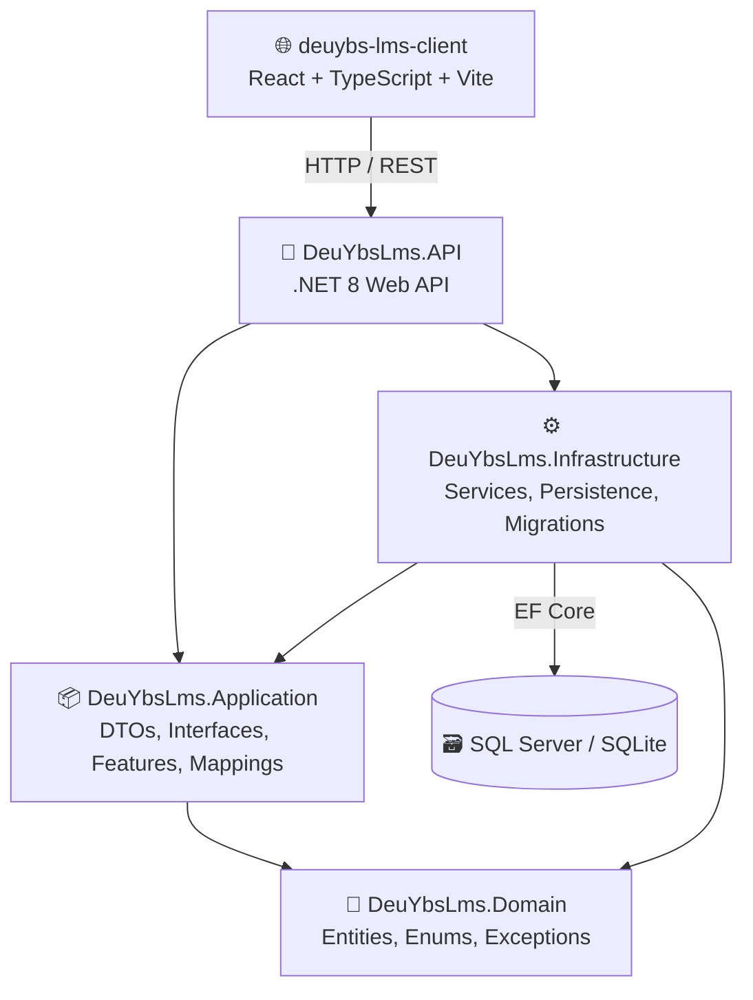
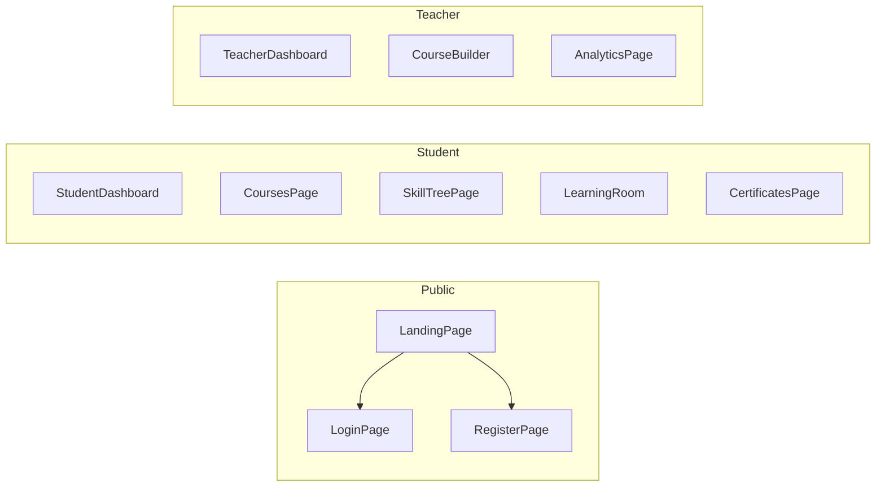

# DeuYbsLms — Proje Genel Görünümü

Dokuz Eylül Üniversitesi Yönetim Bilişim Sistemleri bölümü için geliştirilmekte olan **Öğrenme Yönetim Sistemi (LMS)** projesidir. Gamification (oyunlaştırma) öğeleriyle zenginleştirilmiş, kurs ve ders yönetimi, quiz sistemi, sertifikasyon ve öğretmen paneli içerir.

---

## 🏗️ Mimari (Clean Architecture)

---

## 📂 Backend Katmanları

### 1. Domain Layer — `DeuYbsLms.Domain`
Uygulamanın çekirdek varlıkları ve iş kuralları.

| Klasör | Dosyalar | Açıklama |
|---|---|---|
| `Entities/Course` | `Course`, `Lesson`, `Quiz`, `Question`, `AnswerOption`, `CourseTag` | Kurs ve ders yapısı |
| `Entities/Identity` | `AppUser`, `StudentProfile` | Kullanıcı ve öğrenci profili |
| `Entities/Progress` | `CourseEnrollment`, `LessonProgress`, `Certificate` | Kayıt, ilerleme ve sertifika |
| `Entities/Gamification` | `UserBadge`, `XpTransaction` | Rozet ve XP kayıtları |
| `Enums` | `BadgeType`, `CourseLevel`, `UserRole` | Sabitler |

### 2. Application Layer — `DeuYbsLms.Application`
İş mantığının soyutlaması; DTO'lar, arayüzler ve mapping profilleri.

| Klasör | İçerik |
|---|---|
| `DTOs/` | `Auth`, `Course`, `Gamification`, `Progress` DTO grupları |
| `Interfaces/Services/` | `IAuthService`, `ICertificateService`, `IGamificationService`, `IProgressService`, `ITokenService` |
| `Interfaces/Repositories/` | `IRepository<T>` (generic), `ICourseRepository`, `IEnrollmentRepository`, `ILessonRepository`, `IProgressRepository`, `IUserRepository` |
| `Mappings/` | `MappingProfile.cs` (AutoMapper) |
| `Features/` | `Auth`, `Courses`, `Progress` CQRS-tarzı handler/command'lar |

### 3. Infrastructure Layer — `DeuYbsLms.Infrastructure`
Veritabanı erişimi ve somut servis implementasyonları.

| Klasör | İçerik |
|---|---|
| `Persistence/Context/` | `AppDbContext` (EF Core) |
| `Persistence/Configurations/` | Fluent API entity konfigürasyonları |
| `Persistence/Repositories/` | Repository implementasyonları |
| `Persistence/DbInitializer.cs` | Seed data (başlangıç verileri) |
| `Services/` | `AuthService`, `CertificateService`, `GamificationService`, `ProgressService`, `TokenService` |
| `Extensions/` | DI kayıt extension'ları |
| `Migrations/` | EF Core migration dosyaları |

### 4. API Layer — `DeuYbsLms.API`
REST endpoint'leri.

| Controller | Sorumluluk |
|---|---|
| `AuthController` | Login, Register |
| `CourseController` | Kurs CRUD, listeleme |
| `ProgressController` | Ders ilerleme, quiz submit, kayıt |
| `GamificationController` | XP/Rozet/Seviye bilgileri |
| `CertificateController` | Sertifika listeleme ve doğrulama |

> **Program.cs**: JWT Authentication, Swagger (JWT destekli), CORS, EF Core Seed.

---

## 🖥️ Frontend (React + TypeScript + Vite)

### Sayfa Yapısı

| Sayfa | Dosya | Açıklama |
|---|---|---|
| Landing | `pages/public/LandingPage.tsx` | Ana sayfa |
| Login | `pages/public/LoginPage.tsx` | Giriş |
| Register | `pages/public/RegisterPage.tsx` | Kayıt |
| Student Dashboard | `pages/student/StudentDashboard.tsx` | Öğrenci ana paneli (XP, seviye, istatistikler) |
| Courses | `pages/student/CoursesPage.tsx` | Kurs kataloğu |
| Skill Tree | `pages/student/SkillTreePage.tsx` | Ders ağacı ve ilerleme |
| Learning Room | `pages/student/LearningRoom.tsx` | Video izleme + Quiz |
| Certificates | `pages/student/CertificatesPage.tsx` | Sertifika galerisi |
| Teacher Dashboard | `pages/teacher/TeacherDashboard.tsx` | Öğretmen paneli |
| Course Builder | `pages/teacher/CourseBuilder.tsx` | Kurs/ders/quiz oluşturma |
| Analytics | `pages/teacher/AnalyticsPage.tsx` | Öğrenci analitikleri |

### Bileşenler & Yardımcılar

| Dosya | Açıklama |
|---|---|
| `components/ProtectedRoute.tsx` | Rol tabanlı route koruması |
| `components/VideoPlayer.tsx` | Video oynatıcı |
| `components/QuizModal.tsx` | Quiz modal'ı |
| `components/shared/CourseCompletionModal.tsx` | Kurs tamamlama kutlaması (konfeti) |
| `api/axiosInstance.ts` | Axios base config + JWT interceptor |
| `api/auth.api.ts` | Auth endpoint'leri |
| `api/courses.api.ts` | Kurs endpoint'leri |
| `api/progress.api.ts` | İlerleme endpoint'leri |
| `api/gamification.api.ts` | Gamification endpoint'leri |
| `api/certificate.api.ts` | Sertifika endpoint'leri |
| `store/authStore.ts` | Zustand auth state |
| `types/index.ts` | Tüm TypeScript interface'leri |

---

## ✅ Tamamlanan Adımlar (Önceki Konuşmalar)

1. ✅ **Proje yapısı analizi** — Clean Architecture tanımlandı
2. ✅ **Öğrenci Dashboard**: Statik verilerden dinamik (backend) verilere geçiş
3. ✅ **API endpoint düzeltmeleri**: Frontend-backend uyumu
4. ✅ **Sertifika Sistemi (Step 4)**:
   - Backend: `CertificateService`, `CertificateController`
   - Frontend: `CertificatesPage`, `CourseCompletionModal` (konfeti efekti)
   - DI kayıtları ve build doğrulaması

---

## 🔄 Olası Sonraki Adımlar

Aşağıdakilerden hangisini yapmak isterseniz söyleyin:

1. **🔧 Build & Çalıştırma Testi** — Projenin şu anki build durumunu kontrol edelim
2. **📄 PDF Sertifika İndirme** — jsPDF ile sertifika dışa aktarma
3. **🎨 UI/UX İyileştirmeleri** — Mevcut sayfaların tasarımını güçlendirme
4. **📊 Öğretmen Analitik Paneli** — Daha detaylı istatistikler
5. **🧪 Test Yazma** — Unit/Integration testler
6. **🐛 Hata Giderme** — Bilinen hatalar varsa düzeltme
7. **🆕 Yeni Özellik** — Sizin belirlediğiniz bir özellik
